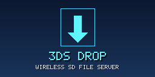
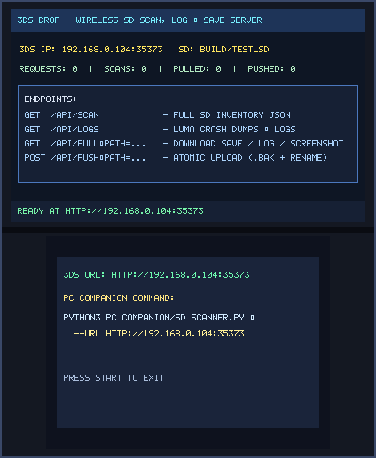
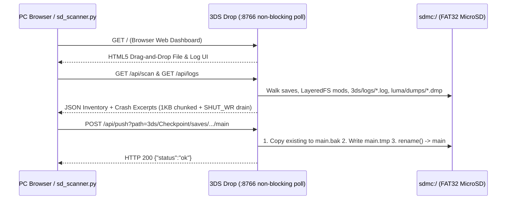

# 3DS Drop (`3ds_drop`)

<p align="center">
  
  &nbsp;&nbsp;&nbsp;
  
</p>

<p align="center">
  
</p>

> **Wireless SD File Server (`CTR-P-DROP`, UniqueId `0x0D3E3`)** — Part of the [**lafiabrew**](https://github.com/orgs/lafiabrew/repositories) Nintendo 3DS Homebrew Suite (companion hub: [`lafiabrew/3ds_hub`](https://github.com/lafiabrew/3ds_hub)).

Zero-friction wireless LAN HTTP & Browser Web UI server (`:8766`) for scanning the 3DS SD card, harvesting crash/app logs, and atomically pushing/pulling Pokémon saves and ROM hacks with `.bak` backups.

---

## Architecture & Data Flow



---

## Controls & Touch Ergonomics (Old 3DS · 2DS · New 3DS XL)

| Button / Input | Action |
|---|---|
| Top & Bottom Screens | Displays live **3DS IP & Port** (`http://<3ds-ip>:8766`) and live request/scan/push/pull counters |
| PC Browser (`GET /`) | Open `http://<3ds-ip>:8766/` on your computer to browse files, view crash logs, download saves, or upload files atomically |
| PC CLI (`sd_scanner.py`) | Run `python3 pc_companion/sd_scanner.py --url http://<3ds-ip>:8766 --dump-logs ./sd_logs` |
| `START` | Gracefully close listening socket and exit |

---

## SD Card Paths & Telemetry Logs

- `GET /` — Interactive browser Web UI for file downloads, atomic uploads, and live log inspection
- `GET /api/status`, `GET /api/scan`, `GET /api/logs` — JSON telemetry and SD inventory endpoints
- `GET /api/pull?path=<rel_path>` & `POST /api/push?path=<rel_path>` — Atomic file transfer (rejects `..` traversal with HTTP 400)
- `sdmc:/3ds/logs/drop.log` — Structured UTC server transfer log

---

## Build, Verify & Install

```bash
# 1. Run host C11 ASan/UBSan pass-the-pass & fail-the-fail unit + UI tests
make test

# 2. Build optimized ARM11 (-Os -flto + stripped ELF) .elf, .smdh, .3dsx, and .cia
make 3ds && make verify-3ds

# 3. Serve FBI QR code or push .cia over LAN via serve_3ds.py
make qr
```
